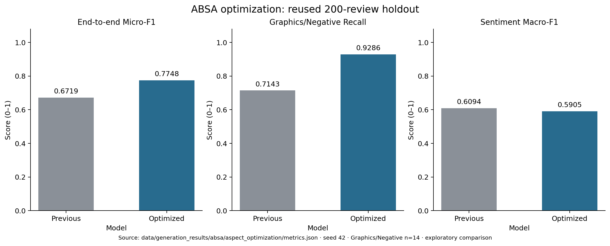
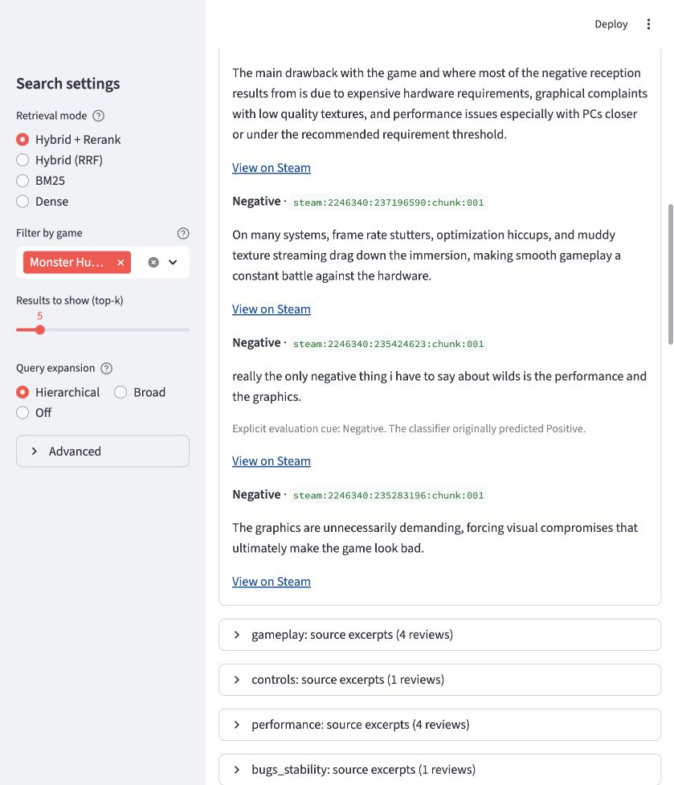

# 4 Generation

The generation stage uses the same ranked Steam review passages for two tasks. Aspect-based sentiment analysis estimates sentiment distributions for each aspect and links predictions to source passages. Evidence-grounded summarization reads the retrieved passages directly and synthesizes a natural-language answer with citations. Section 4.1 presents aspect-based sentiment analysis, and Section 4.2 presents evidence-grounded summarization.

## 4.1 Aspect-Based Sentiment Analysis

The aspect-based sentiment analysis (ABSA) component takes the retrieved Steam review passages and returns aspect mentions, sentiment distributions, and source passage IDs. It covers story, graphics and visuals, gameplay, controls, performance, audio, bugs and stability, and online multiplayer. Each opinion receives a Positive, Negative, or Neutral label. A review counts once per aspect. When different passages from the same review carry opposite labels, the system records a Mixed conflict separately from the three-class percentages.

### Method

The baseline applies word and character TF-IDF to the full review passage. Separate classifiers detect aspects and use subjectivity to inform sentiment classification. This can produce the wrong aspect label when a review praises one feature and criticizes another. For example, two retrieved Monster Hunter Wilds reviews criticized graphics, yet the baseline labeled those opinions Positive.

The optimized model selects sentences or contrast clauses around aspect terms and uses the full passage when it finds no term. The eight aspect detectors combine full-passage TF-IDF with an aspect-term indicator and a frozen, 384-dimensional BGE embedding of the selected context. A shared class-balanced logistic classifier combines local TF-IDF with BGE embeddings to predict sentiment. During training, 1,495 aspect contexts use exact evidence excerpts from training annotations. At inference, the model selects its own context. [BGE model card](https://huggingface.co/BAAI/bge-small-en-v1.5)

A narrow rule handles explicit evaluations followed by an aspect list, such as “the only negative thing is the graphics and performance.” The rule skips negated statements and records the original classifier label whenever it overrides a prediction. The rule was added after inspection of the live errors and retained because it preserved the development objective.

### Evaluation

The data contain 1,000 annotated reviews from 20 games, with one passage per review. We use the original 600/200/200 training, development, and test split, stratified by game and grouped to keep duplicate material together. Mixed and Unclear labels count as aspect mentions and are excluded from three-class sentiment and end-to-end scoring. The test split contains 520 eligible opinions, including 14 negative Graphics opinions and 15 Neutral opinions. Model selection uses a development objective that weights overall end-to-end Micro-F1 at 0.7 and Graphics/Negative end-to-end F1 at 0.3, subject to a maximum overall development F1 drop of 0.01 from the baseline. We reuse the previously inspected test split for this exploratory comparison.

The optimized model improves aspect detection F1 from **0.7989** to **0.8791** and end-to-end Micro-F1 from **0.6719** to **0.7748**. End-to-end micro-precision rises from 0.6889 to 0.7824, and micro-recall rises from 0.6558 to 0.7673. With gold Graphics mentions supplied, negative recall rises from **0.7143** to **0.9286** and negative opinions classified as positive fall from **4/14** to **1/14**. End-to-end Graphics/Negative F1 rises from **0.5600** to **0.7333**.

The local-context hybrid without exact evidence supervision reaches end-to-end Micro-F1 **0.7515** and sentiment Macro-F1 **0.6412**. The selected model improves end-to-end performance but lowers sentiment Macro-F1 from **0.6094** to **0.5905** relative to the baseline. Neutral F1 falls from **0.1667** to **0.0000**, and Graphics/Negative precision falls from **0.8333** to **0.7222**. These trade-offs and the small negative sample limit the conclusions we can draw about generalization. [Evaluation results](../../../data/generation_results/absa/aspect_optimization/summary.txt)

### Integration example

For “Are the graphics of Monster Hunter Wilds worth the performance cost?”, the app runs hybrid retrieval and reranking, then applies ABSA to the five highest-ranked passages. In the integration run, Graphics was mentioned in **4** retrieved reviews and labeled **100.0% Negative**. Performance was mentioned in **4** reviews and labeled **75.0% Negative** and **25.0% Positive**. These percentages describe the retrieved reviews for this query.

With the retrieved passages fixed, both previously identified graphics errors change from Positive to Negative. The local-context classifier corrects one, and the explicit evaluation rule corrects the other. These examples were inspected during development and serve as regression checks. The app displays counts, exact source excerpts, and the rule override when applicable. The JSON output preserves the passage IDs and excerpt offsets for downstream use. [Live verification](../../../data/generation_results/absa/aspect_live_runs/monster_hunter_graphics_performance/validation.json) · [Exported predictions](../../../data/generation_results/absa/aspect_live_runs/monster_hunter_graphics_performance/aspect_results.json)

## 4.2 Evidence-Grounded RAG Summarization

See the [summarization method and experiment setup](../rag_summary/README.md) and [per-method scores](../../../data/generation_results/rouge_results/summary.csv).

### ROUGE summarization results

ROUGE compares generated English summaries with human-reviewed reference answers.
Citation ID markers are removed; text is lowercased into English alphanumeric tokens without stemming.
ROUGE-L uses whole-answer LCS. Scores in JSON/CSV are 0–1; this table shows F1 percentages.
All nine precision/recall/F1 metrics and their valid counts are in summary.csv.
Each method generates independently; transient or invalid responses may be retried. No self-check or evaluator is used.
Per-task latency includes retry attempts and backoff; token totals include all reported attempt usage.

| Method | Completed | Failed | ROUGE-1 F1 | ROUGE-2 F1 | ROUGE-L F1 | Input tokens | Latency s | Text retained |
|---|---:|---:|---:|---:|---:|---:|---:|---:|
| baseline | 79 | 1 | 28.41 | 8.63 | 19.05 | 3276.8734177215188 | 3.9648440253164554 | 1.0 |
| few_shot | 79 | 1 | 29.42 | 10.38 | 20.54 | 4667.0 | 4.448291670886077 | 1.0 |
| compressed | 78 | 2 | 27.63 | 9.04 | 19.15 | 2972.0897435897436 | 4.004229064102564 | 0.7478775276819395 |
| combined | 79 | 1 | 28.97 | 10.23 | 20.39 | 4508.2531645569625 | 4.609231341772152 | 0.7478072697376658 |

### Paired comparisons

ROUGE differences use percentage points; other metrics retain their original units.
| After - before | Metric | Queries | Delta | Bootstrap 95% CI |
|---|---|---:|---:|---:|
| few_shot - baseline | rouge1_f1 | 79 | 1.00509 | [-0.152594, 2.17526] |
| few_shot - baseline | rouge2_f1 | 79 | 1.74832 | [0.951641, 2.5704] |
| few_shot - baseline | rougeL_f1 | 79 | 1.4895 | [0.485179, 2.50271] |
| few_shot - baseline | prompt_tokens | 79 | 1390.13 | [1310.38, 1430] |
| few_shot - baseline | latency_seconds | 79 | 0.483448 | [0.231578, 0.711217] |
| compressed - baseline | rouge1_f1 | 78 | -0.745563 | [-2.20726, 0.758279] |
| compressed - baseline | rouge2_f1 | 78 | 0.395212 | [-0.619645, 1.50137] |
| compressed - baseline | rougeL_f1 | 78 | 0.118517 | [-1.1734, 1.55499] |
| compressed - baseline | prompt_tokens | 78 | -308.5 | [-403.372, -252.013] |
| compressed - baseline | latency_seconds | 78 | 0.0507926 | [-0.164879, 0.247249] |
| combined - baseline | rouge1_f1 | 79 | 0.551889 | [-0.801796, 1.93484] |
| combined - baseline | rouge2_f1 | 79 | 1.5947 | [0.587922, 2.60499] |
| combined - baseline | rougeL_f1 | 79 | 1.33974 | [0.145306, 2.53065] |
| combined - baseline | prompt_tokens | 79 | 1231.38 | [1047.82, 1491.76] |
| combined - baseline | latency_seconds | 79 | 0.644387 | [0.330994, 0.985269] |
| combined - few_shot | rouge1_f1 | 79 | -0.453203 | [-1.96727, 1.08167] |
| combined - few_shot | rouge2_f1 | 79 | -0.153619 | [-1.14108, 0.87012] |
| combined - few_shot | rougeL_f1 | 79 | -0.149756 | [-1.33118, 1.07285] |
| combined - few_shot | prompt_tokens | 79 | -158.747 | [-282.241, 70.3671] |
| combined - few_shot | latency_seconds | 79 | 0.16094 | [-0.0873453, 0.470384] |
| combined - compressed | rouge1_f1 | 78 | 1.29385 | [0.11493, 2.44617] |
| combined - compressed | rouge2_f1 | 78 | 1.20365 | [0.314418, 2.08019] |
| combined - compressed | rougeL_f1 | 78 | 1.19542 | [-0.0447787, 2.39373] |
| combined - compressed | prompt_tokens | 78 | 1541.54 | [1430, 1764.62] |
| combined - compressed | latency_seconds | 78 | 0.621007 | [0.357039, 0.928695] |

### Factorial interactions

Combined - few-shot - compression + baseline; ROUGE differences in percentage points.
| Metric | Queries | Interaction (pp) | Bootstrap 95% CI (pp) |
|---|---:|---:|---:|
| rouge1_f1 | 78 | 0.305 | [-1.345, 1.913] |
| rouge2_f1 | 78 | -0.553 | [-1.615, 0.534] |
| rougeL_f1 | 78 | -0.277 | [-1.843, 1.201] |

Bootstrap sampling uses questions as units, keeping repetitions together.
The split, demonstrations, full and actual evidence, compression spans and settings are saved for each new run.

### Execution

Concurrency: 20; maximum retries: 2.
Generation wall time: 73.789 s; completed answers/s: 4.269.
Each saved row contains all attempts and request totals, including exhausted failures.
